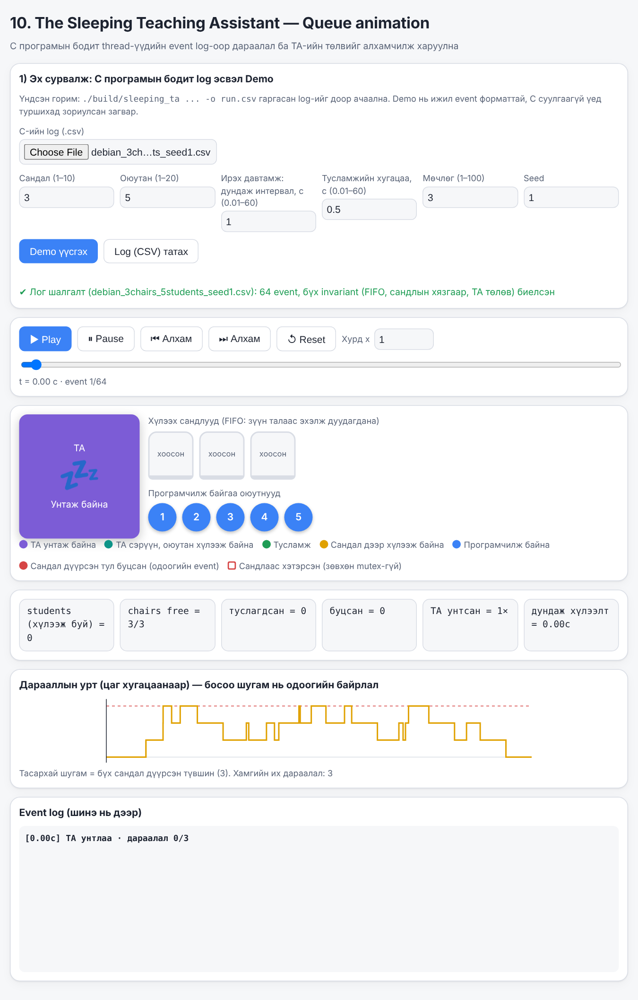
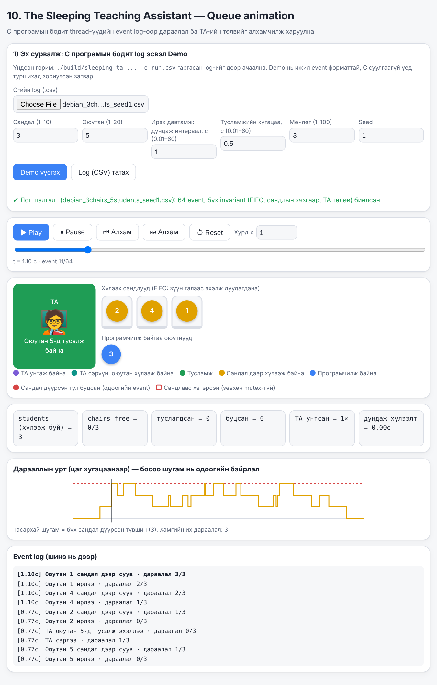
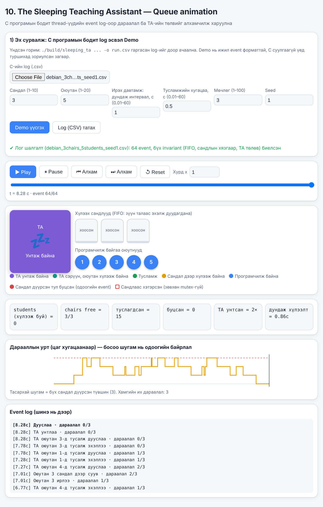
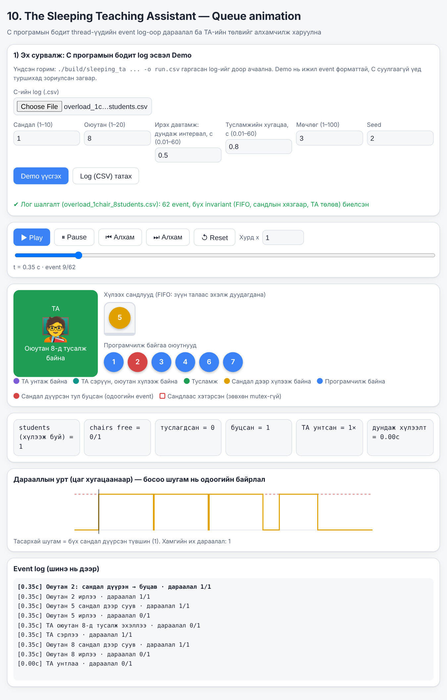
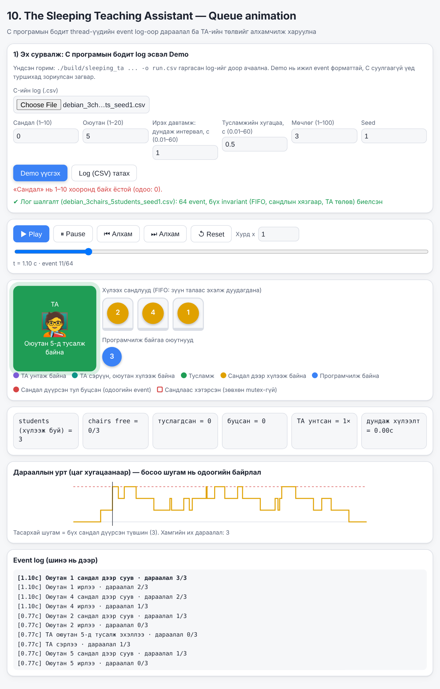
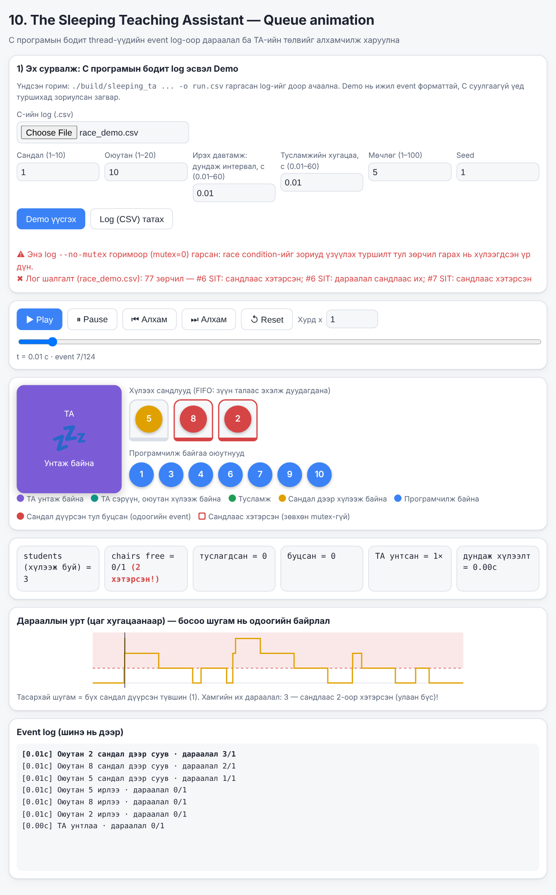

# Manual — The Sleeping Teaching Assistant

## 1. Хэрэглэгчийн заавар
**Зорилго.** TA, хүлээх сандал, оюутнуудын харилцааг (унтах/сэрэх, FIFO дараалал, сандал дүүрэх) алхамчилж харах.
**Дэмжих орчин.** UI: Chrome / Edge / Firefox / Safari-ийн шинэ хувилбар. C програм: Linux, macOS, WSL (gcc/clang, pthread).
**Нээх.** `src/sleeping_ta.html`-г browser-т нээнэ (суулгах зүйлгүй).

**Хоёр эх сурвалж**
1. *C-ийн бодит log (үндсэн):* `./build/sleeping_ta ... -o run.csv` → UI-ийн "C-ийн log" талбараас файл сонгоно.
2. *Demo:* C-гүйгээр талбаруудыг бөглөж **Demo үүсгэх**.

> **Анхаар.** C-ийн log ачаалахад дээд талын талбарууд (Сандал, Оюутан, Ирэх давтамж, Тусламж, Мөчлөг, Seed) log-ийн эхний мөрийн (header) утгаар автоматаар бөглөгдөнө. `--no-mutex` горимоор гарсан (`mutex=0`) log ачаалбал "зөрчил гарах нь хүлээгдсэн үр дүн" гэсэн ⚠ анхааруулга гарна.

**Тохиргоо (Demo).** Сандал 1–10 · оюутан 1–20 · **ирэх давтамж** 0.01–60 с (оюутан дахин ирэх дундаж интервал; бага байх тусам олон ирнэ) · тусламжийн хугацаа 0.01–60 с · мөчлөг 1–100 · seed 0–1000000. Муж нь C програмын `-c -n -p -d -r -s` аргументтай ижил. Мужаас гадуур/хоосон/бүхэл биш утганд улаан мэдээлэл гарч, өмнөх дүрслэл өөрчлөгдөхгүй.

**График.** Дарааллын урт цаг хугацаанаар харагдаж, босоо шугам нь одоогийн event-ийн байрлалыг заана; улаан тасархай шугам нь бүх сандал дүүрсэн түвшин. Дараалал сандлаас хэтэрвэл (зөвхөн `--no-mutex`) тэнхлэг автоматаар томорч, хэтэрсэн бүс улаанаар харагдана.

**Удирдлага.** ▶ Play, ⏸ Pause, ⏭/⏮ нэг event-ээр алхах, slider-аар дурын хугацаанд очих, ↺ Reset, хурд (0.25–20x), "Log (CSV) татах" (Demo-г CSV болгох).

**Тэмдэг, өнгө.** TA-ийн хайрцаг: нил ягаан — TA унтаж байна · ногоон-цэнхэр (teal) — TA сэрүүн, оюутан хүлээж байна · ногоон — тусламж. Оюутны дугуй: шар — сандал дээр хүлээж байна (зүүнээс баруун — дуудагдах дараалал) · цэнхэр — програмчилж байна · улаан — сандал дүүрсэн тул яг одоо буцсан. Улаан хүрээтэй сандал нь сандлаас хэтэрсэн оюутан (зөвхөн `--no-mutex`).
Доорх тоолуур: хүлээж буй (students semaphore-ийн утга), чөлөөт сандал, туслагдсан, буцсан, TA унтсан тоо, дундаж хүлээлт.
**Лог шалгалт.** Log ачаалмагц UI нь C-ийн `check_log`-той ижил дүрмээр автоматаар шалгаж "✔ ... invariant биелсэн" эсвэл "✖ N зөрчил" гэж мэдэгдэнэ. Зөрчил бүр event-ийн дугаартай гарна, жишээ нь `#64 END: END-д queue_len=0 байх ёстой (өгсөн: 2)`.

**Жишээ 1 (дараалал үүсэх).** `-c 3 -n 5 -p 1 -d 0.5 -r 3 -s 1` → TA ихэнхдээ завгүй, дараалал 2–3 хүрнэ (`examples/debian_3chairs_5students_seed1.csv`).
**Жишээ 2 (сандал дүүрэх).** `-c 1 -n 8 -p 0.5 -d 0.8 -r 3 -s 2` (`examples/overload_1chair_8students.csv`) → олон оюутан буцна.
**Жишээ 3 (TA унтах).** `-c 10 -n 3 -p 1 -d 0.4` → дараалал бараг үүсэхгүй, TA байнга унтаж/сэрнэ.
**Жишээ 4 (mutex-гүй race).** `-c 1 -n 10 -p 0.01 -d 0.01 -r 5 -s 1 --no-mutex -q -o race.csv` → `./build/check_log race.csv` FAIL (сандлаас хэтэрсэн); 1–20 seed-ийн 20/20-д нь race илэрсэн (`examples/race_demo.csv`). UI-д хэтэрсэн оюутнууд улаан сандалд харагдана.

**Түгээмэл алдаа**
| Мэдээлэл | Шалтгаан / шийдэл |
|---|---|
| "Header дутуу" | Файл нь C програмын `-o` log биш. `-o run.csv`-ээр дахин үүсгэнэ |
| "Буруу мөр / event" | Log засагдсан эсвэл гэмтсэн. Дахин үүсгэнэ |
| "✖ Лог шалгалт" | Log нь дүрэм зөрчсөн (FIFO, сандлын хязгаар…) — шалтгааныг эхний 3 зөрчлөөс харна |
| C: "Алдаа: chairs (-c) нь 1-10…" | Аргументыг заасан мужид оруулна (exit code 2) |

## 2. Operational заавар
| | |
|---|---|
| Clone | `git clone https://github.com/munkhzayabatochir997-droid/OS_BD1.git && cd OS_BD1` |
| OS / хэрэгсэл | Ubuntu 22.04+ / Debian 12+ / macOS / WSL; gcc ≥ 9 (эсвэл clang), make |
| Туршсан орчин | Debian 13 x86_64, gcc 14.2.0, GNU Make 4.4.1, Node.js 20.19 |
| Dependency | Нэмэлт сангүй (libc, pthread) |
| Build | `make` → `build/sleeping_ta`, `build/check_log` |
| Run | `./build/sleeping_ta -c 3 -n 5 -p 1 -d 0.5 -r 3 -s 1 -o run.csv` |
| Log шалгах | `./build/check_log run.csv` (invariant шалгагч, PASS / FAIL) |
| Автомат тест | `make test` (6 үндсэн/захын + 14 буруу оролт + 2 race (`--no-mutex`) + 5 буруу log (`tests/fixtures/`) = 27; зөвхөн C, нэмэлт сан шаардахгүй) |
| Stress тест | `make stress` (30 янзын тохиргоо, timeout=deadlock илрүүлнэ) |
| Race шалгалт | `make tsan` (ThreadSanitizer) |
| UI тест | `make test-ui` (Node.js; parser, шалгагч, Demo, төлөв сэргээх, 5 буруу log — 24 тест) |
| Гүйцэтгэлийн туршилт | `make sweep` (сандал 1–10, 10 оюутан, 3 seed: буцсан %, дундаж хүлээлт) |
| Нэмэлт boundary/error | `-c 0`, `-c 11`, `-n 21`, `-p -1`, `-d 0`, `-r 0`, `-c abc`, `-c 3.5`, `-s -1` → exit code 2 |
| Хүлээгдсэн үр дүн | Үндсэн тест `PASS: events=…, arrivals=N·R, helped+turned_away=N·R`; `Дүн: 27 амжилттай, 0 бүтэлгүйтсэн`; UI тест `Дүн: 24 амжилттай, 0 бүтэлгүйтсэн`; stress `30 ажиллуулалт, 0 алдаатай` |

**Known issues**
- Цаг хугацааны (sleep) програм тул ижил seed-тэй ч thread-үүдийн interleaving бага зэрэг өөр байж болно (програмчлах хугацаа ижил, event-ийн яг дараалал үл ялих зөрнө). Тиймээс тест нь log-ийн дүрэм (invariant)-ыг шалгадаг.
- Windows (MSVC) дээр pthread/semaphore байхгүй тул WSL ашиглана.
- UI-ийн Demo нь C програмын загвар (бодит thread биш); бодит нотолгоо нь C-ийн log.
- `--no-mutex` горимд race магадлалтай үзэгдэл. Илрүүлэхийн тулд "шалгах → суух" хоорондын цонхыг 1 мс-ээр зориуд өргөсгөдөг; дараалал эвдэрч оюутан гацвал watchdog exit code 3-аар гаргана.
- UI-ийн дүрслэлийг (DOM) автоматаар тестлэдэггүй; тест нь parser, шалгагч, төлөв сэргээх логикийг шалгана.

## 3. Windows хэрэглэгчид (WSL)
C програм POSIX thread/semaphore ашигладаг тул Windows дээр шууд ажиллахгүй; **WSL (Ubuntu)** ашиглана. UI (`sleeping_ta.html`) нь Windows-ийн browser дээр шууд нээгдэнэ.

1. PowerShell-ийг **администратороор** нээж: `wsl --install` → компьютерээ дахин асаана → Ubuntu-д хэрэглэгчийн нэр/нууц үг тохируулна.
2. Ubuntu терминалд:
   ```bash
   sudo apt update && sudo apt install -y build-essential
   ```
3. Repo-г **WSL-ийн дотор** (`~/` доор, `/mnt/c/...` биш) clone хийнэ:
   ```bash
   cd ~ && git clone https://github.com/munkhzayabatochir997-droid/OS_BD1.git && cd OS_BD1
   make test
   ./build/sleeping_ta -c 3 -n 5 -p 1 -d 0.5 -r 3 -s 1 -o run.csv
   ```
4. Гарсан `run.csv`-г Windows-ийн browser-т ачаалахын тулд: Ubuntu-д `explorer.exe .` гэж бичвэл тэр хавтас Windows Explorer-т нээгдэнэ → `run.csv`-г UI-ийн "C-ийн log" талбараас сонгоно.
5. **C-гүйгээр шалгах:** `examples/*.csv` нь C-ийн бодит гаралт тул шууд ачаалж болно; эсвэл UI-ийн **Demo** горим. `examples/race_demo.csv` нь `--no-mutex` log тул ✖ зөрчил гарах нь хүлээгдсэн үр дүн.

| Алдаа (Windows/WSL) | Шалтгаан / шийдэл |
|---|---|
| `$'\r': command not found` (`run_tests.sh`) | Файл CRLF болсон. `sed -i 's/\r$//' tests/*.sh Makefile` эсвэл repo-г WSL дотор дахин clone хийнэ |
| `make: command not found` | `sudo apt install build-essential` |
| `/mnt/c/...` дээр удаан/permission алдаа | Repo-г `~/` доор clone хийнэ |
| PowerShell-д монгол үсэг эвдэрнэ (`cat README.md`) | `Get-Content README.md -Encoding UTF8` эсвэл GitHub/VS Code-оор нээнэ |
| Windows-ийн `Documents` дотор clone хийхэд `could not create work tree dir` | Controlled folder access/OneDrive хориглож байна; `C:\Users\<нэр>\projects` гэх мэт өөр хавтсанд clone хийнэ |

## 4. Туршилтын нотолгоо (Debian 13)
Дээрх Operational зааврыг дагаж гүйцэтгэсэн. Бүрэн гаралт `docs/results/` ба эцсийн хувилбарынх `docs/results_bd2/`-д.

| Алхам | Команд | Үр дүн | Гаралт |
|---|---|---|---|
| Build | `make` | warning-гүй амжилттай | `results_bd2/14_after3_build.txt` |
| Run | `./build/sleeping_ta -c 3 -n 5 -p 1 -d 0.5 -r 3 -s 1 -o run.csv` | ирэлт 15 = туслагдсан 15 + буцсан 0, дараалал ≤ 3, FIFO | `results/02_run.txt` |
| Автомат тест | `make test` | 27 амжилттай, 0 бүтэлгүйтсэн | `results_bd2/15_after3_make_test.txt` |
| UI тест | `make test-ui` | 24 амжилттай, 0 бүтэлгүйтсэн | `results_bd2/12_after2_test_ui.txt` |
| Stress | `make stress` | 30 ажиллуулалт, 0 алдаа | `results_bd2/16_after3_stress.txt` |
| TSan | `make tsan` | data race илрээгүй, PASS | `results_bd2/17_after3_tsan.txt` |
| Сандлын тоо | `make sweep` | сандал 1→7: буцсан 44%→0%, хүлээлт 53→382 мс | `results_bd2/18_sweep.csv` |
| X1 нэмэлт | Run-ийн log-ийг `build/check_log`-оор шалгах | PASS | `results/06_extra_tests.txt` |
| X2 нэмэлт | `-c 2 -n 20 -p 0.2 -d 0.5 -r 2 -s 7` (хэт ачаалал) | 40 = 6 + 34 буцсан, дараалал ≤ 2, гацаагүй | `results/06_extra_tests.txt` |
| X3 нэмэлт | Ижил seed (42)-ээр 2 удаа | хураангуй үр дүн ижил | `results/06_extra_tests.txt` |
| X4 нэмэлт | `-c 1 -n 10 -p 0.01 -d 0.01 -r 5 --no-mutex`, seed 1–20 | 20/20-д race илэрсэн → mutex зайлшгүй | `results_bd2/13_race_cmd_compare.txt` |

**UI screenshot** (`docs/images/`)

| Зураг | Тайлбар |
|---|---|
|  | `ui_01`: run.csv, event 1 — TA унтаж байна, дараалал хоосон |
|  | `ui_02`: event 11 — 3/3 сандал дүүрэн (2→4→1 FIFO), TA 5-р оюутанд тусалж байна; terminal-ийн гаралттай таарна |
|  | `ui_03`: event 64 — туслагдсан 15, буцсан 0, TA унтсан 2×; ✔ invariant |
|  | `ui_04`: overload log — 1 сандал дүүрэн, 2-р оюутан 🔴 буцсан |
|  | `ui_05`: Сандал = 0 → улаан алдаа, өмнөх дүрслэл хэвээр |
|  | `ui_06`: `--no-mutex` log — ✖ 43 зөрчил, 1 сандалтай үед дараалал 2 болсон |
