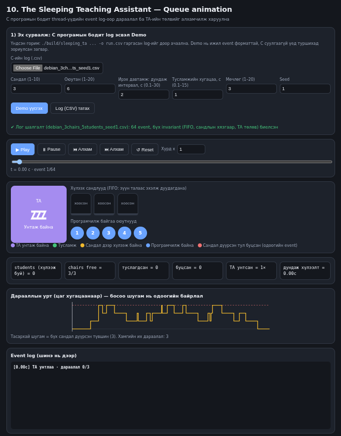
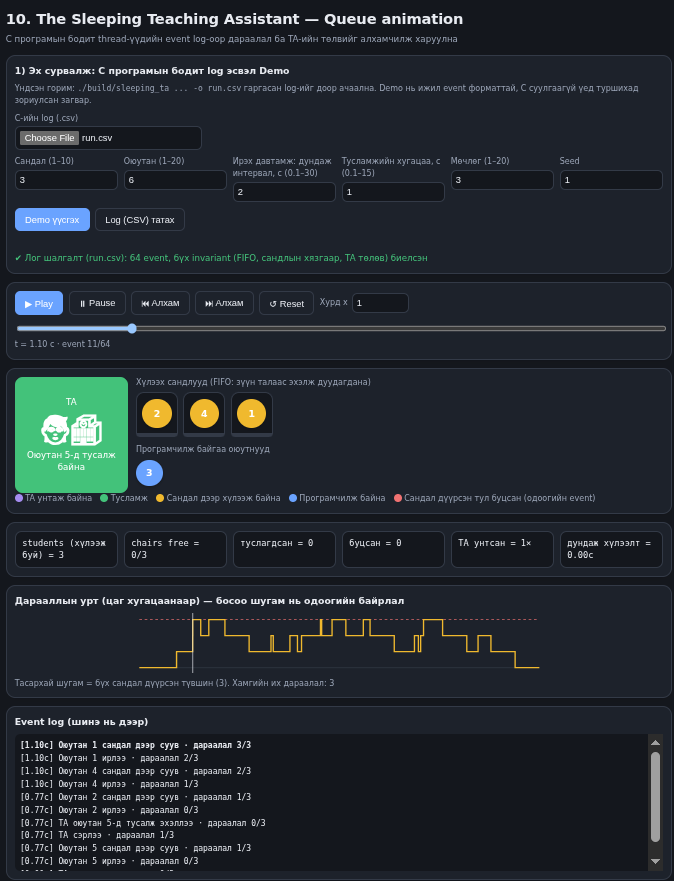
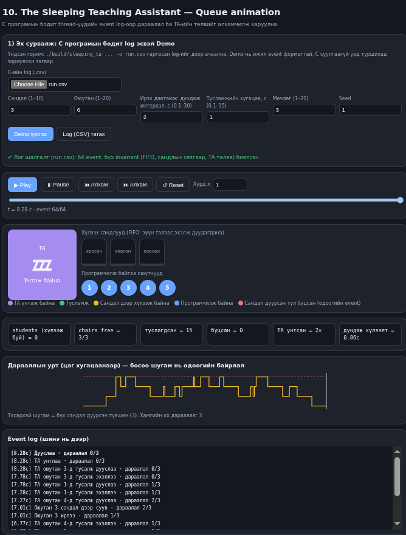
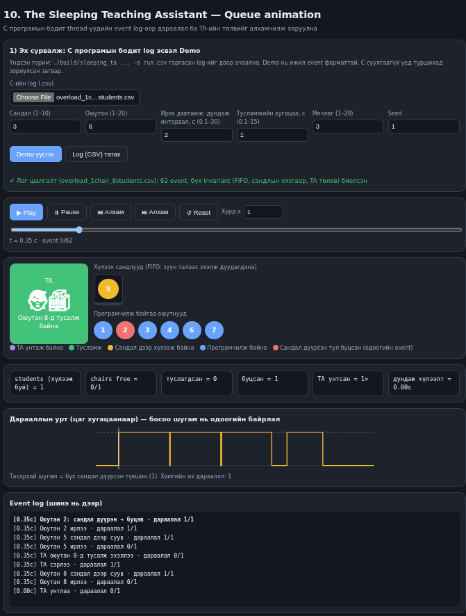
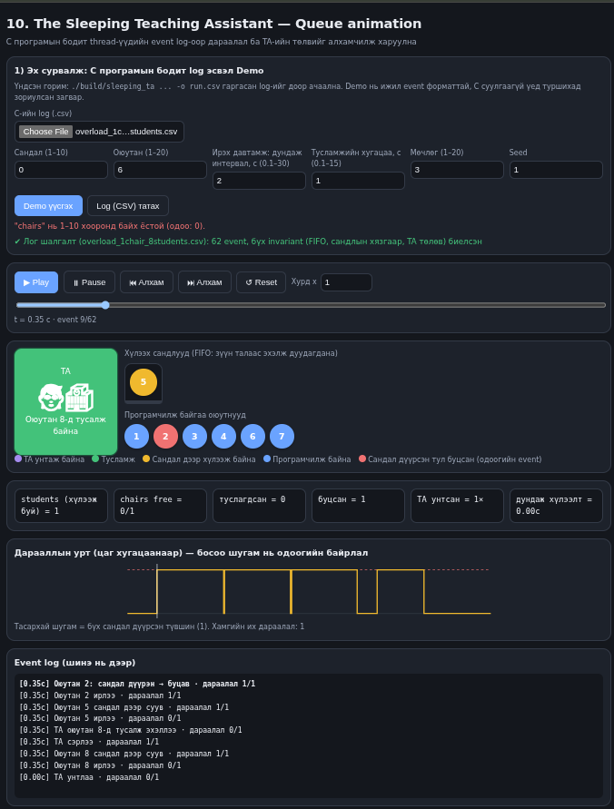
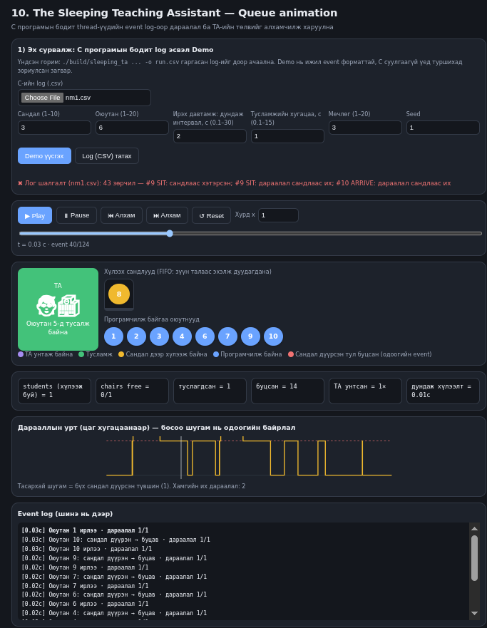

# F.CSM302 Үйлдлийн систем — Бие даалт 1: Тайлан (ноорог)
**Төсөл:** 10. The Sleeping Teaching Assistant · **Бүлэг:** Synchronization Examples · **Дүрслэл:** Queue animation
**Гишүүд:** <нэр, ID> … · **Repository:** https://github.com/munkhzayabatochir997-droid/OS_BD1 · **Release/Tag:** v1.0 (9-р долоо хоног)
> `< >`-д тэмдэглэсэн хэсгийг багаараа бөглөж, PDF болгоно.

## Хураангуй
Нэг TA, N хүлээх сандал, олон оюутны thread-ийг POSIX semaphore ба mutex-ээр синхрончлон C (Pthreads) дээр хэрэгжүүллээ. Програм нь thread-үүдийн бодит event log (CSV) гаргаж, HTML UI тэр log-оор дараалал ба TA-ийн төлвийг алхамчилж харуулна. Зөв ажиллагааг 22 C автомат тест (6 үндсэн/захын, 14 буруу оролт, 2 race), 19 UI model тест, 30 тохиргоотой stress тест, ThreadSanitizer, бие даасан log шалгагч (invariant) болон багийн нэмэлт 4 туршилтаар нотолсон. `--no-mutex` горимд race condition ба гацалт гарч байгааг харуулж, mutex зайлшгүй гэдгийг туршилтаар баталсан.

## 1. Удиртгал
Sleeping TA нь producer–consumer төрлийн сонгодог синхрончлолын бодлого. Зорилго: нөхцөлийг (сандал, ирэх давтамж, үйлчилгээний хугацаа) өөрчилж турших боломжтой, ажиллагааг нь нүдээр баталгаажуулах хэрэгжилт хийх. Хамрах хүрээ: нэг TA, ≤10 сандал, ≤20 оюутан; thread-ээр дуурайлгасан (бодит хэрэглэгчийн ачаалалгүй).

## 2. Сурах бичгийн шаардлага
TA өрөөнд n сандалтай. Хүлээж буй оюутан байхгүй бол TA унтана. Оюутан ирэхэд TA унтаж байвал сэрээнэ; завгүй бол сандал чөлөөтэй үед суугаад хүлээнэ; дүүрэн бол буцаж дараа ирнэ. Pthreads, mutex, semaphore ашиглана.

## 3. Онолын үндэс
- **Race condition:** `waiting`/дараалал дээр хоёр оюутан зэрэг "сандал чөлөөтэй" гэж шалгавал сандлаас хэтэрнэ → **mutex**-ээр критик хэсгийг хамгаална.
- **Counting semaphore:** `students_sem` нь хүлээж буй оюутны тоо; 0 үед TA `sem_wait`-д **унтана**, оюутан `sem_post` хийхэд сэрнэ. Lost wake-up гарахгүй: `sem_post` нь тоолуурт хадгалагддаг.
- **Deadlock-гүй байх:** mutex-ийг блоклох үйлдлийн (`sem_wait`, `sleep`) үед барьдаггүй; түгжээний дараалал ганц (`m` → `lm`).
- **Starvation:** дараалал FIFO тул суусан оюутан заавал дуудагдана. Сандал дүүрэн үед буцсан оюутан дахин оролдоно (номын нөхцөл).

## 4. Системийн зохиомж
Thread: 1 TA + N оюутан + main. Хуваалцсан төлөв (`queue[]`, `qcount`, `ta_done`) mutex `m`-ээр; оюутан бүрт `call_sem[i]` (TA дуудсан), `fin_sem[i]` (тусламж дууссан) semaphore. Event бүр `lm` түгжээн дотор хугацаатай бичигдэх тул log-ийн дараалал бодит дарааллыг (state өөрчлөлтийн дарааллыг) илэрхийлнэ.
Өгөгдлийн урсгал: `student → (m) queue → students_sem → TA → call_sem → student → fin_sem`. Log: `time_ms,event,student,queue_len` (ARRIVE, SIT, FULL, TA_SLEEP, TA_WAKE, HELP_START, HELP_END, END).

## 5. Хэрэгжилт
`src/sleeping_ta.c`: `getopt` аргумент шалгалт (муж, төрөл), `nanosleep`-ээр бодит хугацаа, `rand_r` (thread тус бүрт seed) — програмчлах хугацаа ижил seed-ээр давтагдана. TA `TA_SLEEP`-ийг дараалал хоосон үед mutex дотор логлоно; бүх оюутан дуусмагц main `ta_done=1` + `sem_post` хийж TA-г цэвэрхэн гаргана. `--no-mutex` горим нь критик хэсгийн хамгаалалтыг зориуд унтрааж race-ийг харуулна (log header-т `mutex=0`). `tests/check_log.c`: log-ийн invariant-ыг бие даан шалгагч. `src/sleeping_ta.html`: log parser, invariant validator, `stateAt(idx)` дахин тоглуулагч, Demo generator.
Анхаарах сонголт: TA унтаж байхад ирсэн оюутан эхлээд сандал дээр сууж (`SIT`), дараа нь TA-г сэрээнэ (номын жишиг).

**GitHub дээрх хамтын ажил.** Repository-д `src/`, `tests/`, `examples/`, `docs/` бүтэцтэй; push бүрт GitHub Actions (`.github/workflows/ci.yml`) тестийг автоматаар ажиллуулна. Гишүүд тусдаа branch дээр ажиллаж Pull Request-ээр нэгтгэсэн (жишээ: `suhamar-manual` — Manual-ийг өөр машин дээр шалгаж, туршилтын нотолгоо нэмсэн). <Гишүүн бүрийн хариуцсан ажил — docs/Work_plan.md>

## 6. Туршилт ба UI дүрслэл
Өөрчилж турших: `-c -n -p -d -r -s` (C), мөн UI-ийн Demo талбарууд. Ажиглах: дараалал, TA төлөв, буцсан оюутан, тоолуур, дарааллын уртын график. Удирдлага: Play/Pause/алхам/slider/Reset/хурд. Сурах бичигт заасан дүрслэл (сандал, дараалал, TA төлөв) бүгд C-ийн бодит log-оос гарна; log-ийг UI өөрөө шалгаж ✔/✖ мэдэгдэнэ.

UI нь C-ийн гаралттай нийцэж буйг шалгасан: `-c 3 -n 5 -p 1 -d 0.5 -r 3 -s 1` ажиллуулалтын terminal гаралтад 1104.5 ms-д дараалал 3/3 (2→4→1) болж TA 5-р оюутанд тусалж байсан бөгөөд UI-ийн event 11 яг ижил төлөвийг харуулсан (зураг U2). Эцсийн тоолуур (туслагдсан 15, буцсан 0, TA унтсан 2×) terminal-ийн "Дүн" мөртэй таарсан (U3).

| | |
|---|---|
|  | **U1.** Эхлэл: TA унтаж байна, дараалал хоосон |
|  | **U2.** 3/3 сандал дүүрэн, FIFO дараалал, TA тусалж байна |
|  | **U3.** Дууссан: тоолуур ба ✔ invariant |
|  | **U4.** 1 сандал дүүрэн → 2-р оюутан 🔴 буцсан |
|  | **U5.** Буруу оролт (сандал = 0) → улаан мэдээлэл, өмнөх дүрслэл хэвээр |
|  | **U6.** `--no-mutex` log: ✖ 43 зөрчил, 1 сандалтай үед дараалал 2 |

## 7. Туршилтын арга
Орчин: Debian 13 x86_64, gcc 14.2.0, GNU Make 4.4.1, Node.js 20.19 (UI model тест); цэвэр clone дээр Manual-ийн алхмыг өөрчлөлтгүй дагав. Хүлээгдсэн үр дүн нь тест бүрд `tests/test_cases.md`-д. Үндсэн шалгуур — invariant: queue_len ≤ chairs, FIFO, TA нэг дор нэг оюутанд, унтах/сэрэх зөв, FULL зөвхөн дүүрэн үед, оюутан бүр `rounds` удаа, helped+turned_away = N·rounds, END-д дараалал хоосон. Цаг хугацаатай програм тул тоон үр дүнг биш, invariant-ыг шалгуур болгосон. Бүх гаралт `docs/results/`-д.

## 8. Үр дүн
**Үндсэн ба захын тест** (`make test`, `docs/results/03_make_test.txt`)

| Тест | Тохиргоо (c,n,p,d,r,s) | helped | turned away | max queue | TA sleeps | Үр дүн |
|---|---|---|---|---|---|---|
| T1 | 3,5,0.3,0.2,3,1 | 13 | 2 | 3 | 2 | PASS |
| T2 | 1,10,0.1,0.3,2,2 | 4 | 16 | 1 | 2 | PASS |
| T3 | 10,3,0.3,0.1,3,3 | 9 | 0 | 1 | 6 | PASS |
| T4 | 1,1,0.1,0.1,5,4 | 5 | 0 | 1 | 6 | PASS |
| T5 | 10,20,0.1,0.05,3,5 | 33 | 27 | 10 | 2 | PASS |
| T6 | өөр seed | 11 | 13 | 2 | 2 | PASS |

**Бусад автомат шалгалт**

| Шалгалт | Үр дүн | Гаралт |
|---|---|---|
| Буруу оролт E1–E14 (`-c 0/11/abc/3.5`, `-n 0/21`, `-p -1`, `-d 0`, `-r 0`, `-s -1`, үл мэдэгдэх сонголт, илүү аргумент, log нээгдэхгүй) | 14/14: exit code 2 (log нээгдэхгүй үед 1) + ойлгомжтой мэдээлэл | `03_make_test.txt` |
| Race N1–N2 (`--no-mutex`) | race илэрсэн, header-т `mutex=0` | `03_make_test.txt` |
| `make test` нийт | 22 амжилттай, 0 бүтэлгүйтсэн | `03_make_test.txt` |
| Stress (`make stress`) | 30 ажиллуулалт, 0 алдаа (deadlock/timeout үгүй) | `04_stress.txt` |
| ThreadSanitizer (`make tsan`) | data race мэдээлэгдээгүй, log PASS | `05_tsan.txt` |
| UI model (`node tests/test_ui_model.js`) | 19/19: Demo invariant, C-ийн бодит 4 log, CRLF, round-trip, буруу log илрүүлэлт 6 | `07_ui_model.txt` |

**Багийн нэмэлт туршилт** (`06_extra_tests.txt`)

| Тест | Тохиргоо | Үр дүн | Ажиглалт |
|---|---|---|---|
| X1 | Run-ийн log-ийг `check_log`-оор | PASS, 15 = 15 + 0 | Бодит log invariant хангасан |
| X2 | 2,20,0.2,0.5,2,7 (хэт ачаалал) | PASS, 40 = 6 + 34, max queue 2 | 85% буцсан ч сандлын хязгаар хадгалагдаж, гацаагүй |
| X3 | 3,5,0.3,0.2,3,42 × 2 | Хоёулаа 13 / 2 / 3 / 2 | Ижил seed-ээр хураангуй давтагдана |
| X4 | `--no-mutex` 1,10,0.01,0.01,5, seed 1–5 | 5/5 зөрчилтэй (29, 53, 78, 43, 259), seed 5 гацсан (WATCHDOG) | Mutex-гүйгээр сандлаас хэтрэх, lost wake-up/гацалт гарна → mutex зайлшгүй |

Ажиглалт: сандал цөөн/тусламж урт үед буцах хувь огцом өснө (T2: 16/20, X2: 34/40 буцсан), сандал элбэг үед TA ихэнхдээ унтана (T3, T4: 6 удаа).

## 9. Хэлэлцүүлэг
- Цаг хугацаатай програм тул log яг давтагдахгүй. Жишээ нь T5-ийг өөр машин дээр ажиллуулахад 34/26 биш 33/27, T3-д TA 7 биш 6 удаа унтсан; гэвч invariant бүгд биелсэн. Тиймээс нотолгоог "яг тэр гаралт" биш invariant-аар хийсэн нь зөв сонголт.
- `--no-mutex` туршилт (X4, U6) нь онолын хэсгийн race condition ба lost wake-up-ийг бодитоор харуулсан: 1 сандалтай үед дараалал 2 болж, нэг ажиллуулалт гацсан.
- Invariant шалгагч нь буруу log-ийг илрүүлдгийг (FIFO/сандлын хязгаар/END) тестээр баталсан боловч бүх interleaving-ийг шавдаггүй (хязгаарлагдмал хамрах хүрээ).
- UI-ийн Demo нь загвар; бодит нотолгоо нь C-ийн log. UI-ийн Demo талбарын муж (мөчлөг 1–20, тусламж 0.1–15 с) C-ийнхээс (1–100, 0.01–60 с) явцуу.
- Windows-д шууд ажиллахгүй (WSL).

## 10. Дүгнэлт
Sleeping TA-г бодит thread/semaphore/mutex-ээр хэрэгжүүлж, тохиргоо өөрчлөх, бодит log-оор animation хийх, автомат тест + stress + TSan-аар зөв ажиллагааг нотолсон; Manual-ийн дагуу өөр машин (Debian 13) дээр дахин ажиллуулж ижил дүгнэлтэд хүрсэн. Цаашид: бодит хугацаа биш виртуал цаг, хэд хэдэн TA, priority дараалал, UI legend-д TA-ийн сэрүүн төлвийг тусдаа өнгөөр ялгах.

## Ашигласан материал
Silberschatz, Galvin, Gagne — *Operating System Concepts*, Programming Projects (Sleeping TA); POSIX Threads / `sem_overview(7)`; Claude (Anthropic) — код, тест, баримтын эхний хувилбарт болон туршилт, баримт шинэчлэхэд туслав (багаар шалгасан).
