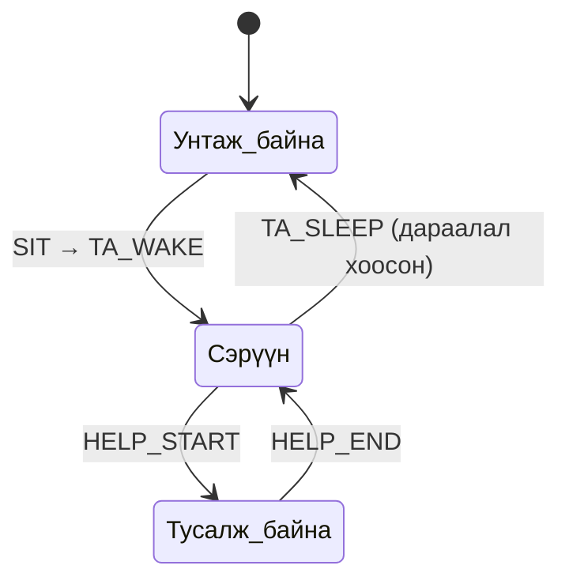
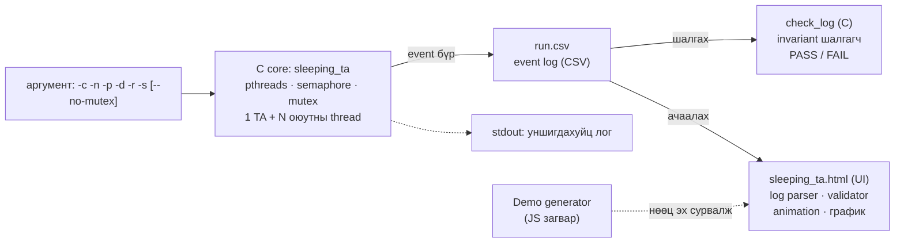

# Бие даалт №1. The Sleeping Teaching Assistant тайлан

**Шинжлэх Ухаан Технологийн Их Сургууль · Мэдээлэл, Холбооны Технологийн Сургууль**
**F.CSM302 Үйлдлийн систем**

| | |
|---|---|
| **Сэдэв** | Synchronization Examples: The Sleeping Teaching Assistant (Programming Project), Queue animation |
| **Хуваарилалтын код** | V-1-10 |
| **Шалгасан багш** | Г.Ганбат /F.CS10/ |
| **Гүйцэтгэсэн оюутан** | Б.Мөнхзаяа /B241940022/, Н.Сүх-Амар /B231940125/, /B221940502/, /B241910033/, /B242270802/ |
| **Repository** | https://github.com/munkhzayabatochir997-droid/OS_BD1 |

Улаанбаатар хот, 2026 он

---

## Хураангуй

**Асуудал.** Sleeping Teaching Assistant бол сонгодог синхрончлолын бодлого. Нэг TA, хязгаарлагдмал тооны хүлээх сандал, олон оюутны thread дундын дараалал дээр зэрэг ажиллана. TA-д хүлээж буй оюутан байхгүй бол унтаж, оюутан ирэхэд сэрэх; сандал дүүрэн бол оюутан буцах ёстой. Дарааллыг өөрчлөх хэсэгт хоёр thread зэрэг орвол сандлаас хэтрэх (race condition), TA-г сэрээх дохио алдагдах (lost wake-up) аюултай.

**Шийдэл.** Сурах бичгийн Programming Project-ийн дагуу C хэл, POSIX thread, counting semaphore болон mutex ашиглан хэрэгжүүлэв. Програм thread-үүдийн бодит event log-ийг (CSV) гаргана. HTML UI тэр log-ийг ачаалж, сандал, FIFO дараалал, TA-ийн төлвийг (унтаж байна / тусалж байна) алхамчилж, slider-аар дахин тоглуулна (Queue animation), дарааллын уртын график зурна. Log ачаалмагц UI үүнийг автоматаар шалгаж (invariant) ✔ эсвэл ✘ гэж мэдэгдэнэ. C суулгаагүй үед туршихад зориулсан Demo горим бий. Нэмэлтээр `--no-mutex` горимоор race condition-ийг зориуд үүсгэж харуулдаг.

**Туршилт.** 22 C автомат тест (6 үндсэн/захын, 14 буруу оролт, 2 race), 19 UI model тест, 30 тохиргоотой stress тест, ThreadSanitizer, мөн бие даасан log шалгагч (`check_log.c`) ашиглав. Manual-ийг өөрчлөлтгүй дагаж, цэвэр clone дээр Debian 13 орчинд дахин ажиллуулж нотолгоог цуглуулсан.

**Гол үр дүн.** Mutex-тэй бүх ажиллуулалтад (T1–T6, stress 30/30, TSan, X1–X3) invariant биелсэн: дарааллын урт ≤ сандал, FIFO, TA нэг дор нэг оюутанд тусална, туслагдсан + буцсан = нийт ирэлт. `--no-mutex` горимд 5 ажиллуулалтын 5-д нь зөрчил илэрч (29–259 зөрчил), нэг нь гацсан тул watchdog зогсоосон. Энэ нь mutex зайлшгүй гэдгийг туршилтаар баталсан.

**Хязгаарлалт (товч).** Цаг хугацаатай (sleep) програм тул ажиллуулалт бүрт log яг ижил гарахгүй; иймд нотолгоог тоон үр дүн биш invariant-аар хийсэн. UI-ийн Demo нь C-ийн загвар (бодит thread биш). macOS-ийг гараар туршаагүй (зөвхөн CI). Дэлгэрэнгүйг 9.3 хэсэгт.

---

## Гарчиг

1. [Удиртгал](#1-удиртгал)
2. [Сурах бичгийн шаардлага](#2-сурах-бичгийн-шаардлага)
3. [Онолын үндэс](#3-онолын-үндэс)
4. [Системийн зохиомж](#4-системийн-зохиомж)
5. [Хэрэгжилт](#5-хэрэгжилт)
6. [Туршилт ба UI дүрслэл](#6-туршилт-ба-ui-дүрслэл)
7. [Туршилтын арга](#7-туршилтын-арга)
8. [Үр дүн](#8-үр-дүн)
9. [Хэлэлцүүлэг](#9-хэлэлцүүлэг)
10. [Дүгнэлт](#10-дүгнэлт)
11. [Ашигласан материал](#ашигласан-материал)
12. [Хавсралт A. Ажлын төлөвлөгөө](#хавсралт-a-ажлын-төлөвлөгөө)

---

## 1. Удиртгал

### 1.1 Зорилго

Сурах бичгийн Synchronization Examples бүлгийн Programming Project болох The Sleeping Teaching Assistant-ийг бүрэн хэрэгжүүлж, хэрэглэгч сандлын тоо, оюутны ирэх давтамж, үйлчилгээний хугацааг өөрчилж турших боломжтой програм бүтээх. Багшийн оноосон Queue animation дүрслэлээр waiting queue болон TA-ийн төлвийг алхамчилсан байдлаар харуулж, хэрэгжилт ба туршилтын үр дүнг баримтжуулах.

### 1.2 Ач холбогдол

Хязгаартай дарааллаар үйлчилдэг системд (принтерийн дараалал, сүлжээний буфер, хүлээлгийн өрөө гэх мэт) нөөцийн тоо хязгаартай, үйлчлэгч нь ажилгүй үедээ унтдаг, шинэ хүсэлт ирэхэд сэрдэг бүтэц түгээмэл тохиолддог. Mutex ба semaphore-ийг зөв хослуулах, race condition болон lost wake-up-ийг таних нь зэрэгцээ программчлалын үндсэн чадвар юм. Thread-үүдийн ажиллагаа нүдэнд харагддаггүй тул бодит програмын үйлдлийг дүрслэх нь ойлголтыг ихээхэн хөнгөвчилнө.

### 1.3 Хамрах хүрээ

- C хэл дээрх TA ба N оюутны thread, FIFO хүлээх сандлууд (1–10), counting semaphore, mutex (сурах бичгийн үндсэн шаардлага).
- Оролт, параметрийг өөрчилж дахин турших (`-c -n -p -d -r -s`); буруу ба захын оролтыг шалгаж ойлгомжтой мэдээлэх.
- Thread-үүдийн бодит event log (CSV) гаргах, түүнийг бие даан шалгах (`check_log`), UI-д animation хэлбэрээр дахин тоглуулах.
- `--no-mutex` горимоор race condition-ийг зориуд үүсгэж илрүүлэх.
- Автомат тест, stress, ThreadSanitizer, GitHub Actions CI, хэрэглэгчийн ба operational гарын авлага (Manual).

Олон TA, priority дараалал, бодит хэрэглэгчийн ачаалал, Windows-ийн шууд (MSVC) хувилбар хамрах хүрээнд ороогүй.

---

## 2. Сурах бичгийн шаардлага

### 2.1 Programming Project-ийн үндсэн шаардлага

Компьютерийн ухааны тэнхимийн TA оюутнуудад программчлалын даалгавраар тусалдаг. TA-ийн өрөө жижиг тул ганц ширээ, сандалтай; өрөөний гадна коридорт хүлээх сандлууд (номд 3) байна. Бодлогын нөхцөл:

- Тусламж хүсэгч оюутан байхгүй үед TA ширээнийхээ ард унтана.
- Оюутан ирэхэд TA унтаж байвал оюутан TA-г сэрээж тусламж хүснэ.
- TA өөр оюутанд тусалж байвал ирсэн оюутан хүлээх сандалд суугаад хүлээнэ.
- Сандал бүгд дүүрэн бол оюутан буцаад дараа дахин ирнэ.
- TA болон оюутнуудыг Pthreads thread-ээр дүрсэлж, mutex lock ба semaphore-оор синхрончилно.

### 2.2 Багшийн нэмэлт шаардлага

Бие даалт 1-ийн удирдамжийн дагуу: оролт, нөхцөл, параметрийг өөрчилж дахин турших; буруу ба захын оролтыг шалгаж ойлгомжтой мэдээлэх; номын жишээ болон нэмэлт туршилтаар зөв ажиллагааг нотлох; өөр компьютерт Manual-ийн дагуу дахин ажиллуулах боломжтой байх; GitHub repository, README, багаар хамтран ажиллах. Төсөлд оноосон дүрслэл: сандлын тоо, оюутны ирэх давтамж, үйлчилгээний хугацааг тохируулж, waiting queue болон TA-ийн төлвийг хөдөлгөөнт эсвэл алхамчилсан байдлаар харуулна.

### 2.3 Шаардлагын хангалт

**Хүснэгт 2.1.** Шаардлага ба хэрэгжсэн газар

| Шаардлага | Хэрэгжилт |
|---|---|
| Нэг TA, олон оюутны thread | `ta_thread`, `student_thread` (`pthread_create`); `main` нь бүгдийг join хийнэ |
| n хүлээх сандал, FIFO дараалал | `queue[]` тойрог массив, `qhead`/`qcount`; сандал `-c` (1–10) |
| TA унтах / сэрэх | `students_sem` counting semaphore (0 үед TA `sem_wait`-д унтана); `TA_SLEEP`, `TA_WAKE` event |
| Сандал дүүрэн бол буцах | `qcount < chairs` шалгаж, үгүй бол `FULL` event, оюутан дараа дахин ирнэ |
| mutex lock | `m` (дараалал, qcount, тоолуур), `lm` (log-ийн мөр холилдохгүй) |
| Параметр өөрчилж дахин турших | `-c -n -p -d -r -s -o -q`, UI-ийн Demo талбарууд, Reset |
| Буруу / захын оролтыг шалгах | `pint`/`pdbl`: муж, төрөл шалгаж exit code 2 + ойлгомжтой мэдээлэл (E1–E14) |
| Queue animation, бодит ажиллагаатай холбох | UI нь C-ийн бодит log-ийг дахин тоглуулна (сандал, дараалал, TA төлөв, график, тоолуур) |
| Өөр компьютерт Manual-аар ажиллуулах | Debian 13 дээр цэвэр clone, Manual-ийн алхмыг өөрчлөлтгүй дагаж дахин ажиллуулсан (7.1) |
| Нэмэлт туршилт | Stress 30, ThreadSanitizer, `--no-mutex` race, X1–X4, UI model тест |
| GitHub repository | README, `src/` `tests/` `examples/` `docs/`, CI (Ubuntu + macOS), branch + Pull Request (5.8) |

---

## 3. Онолын үндэс

### 3.1 Critical section ба race condition

Хуваалцсан өгөгдлийг хэд хэдэн thread зэрэг өөрчлөх үед үр дүн нь гүйцэтгэлийн дарааллаас хамаардаг бол үүнийг race condition гэнэ. Манай бодлогод дараалалд суух үйлдэл нь хэд хэдэн алхмаас бүрдэнэ: (1) `qcount < chairs` эсэхийг шалгах, (2) `queue[...] = id`, (3) `qcount++`. Хоёр оюутан зэрэг (1)-ийг давбал хоёулаа суугаад сандлаас хэтэрнэ, эсвэл нэг нь нөгөөгийнхөө нүдийг дарж бичээд дарааллаас алга болно. Иймд энэ хэсэг critical section бөгөөд харилцан гадуурхал (mutual exclusion), ахиц (progress), хязгаартай хүлээлт (bounded waiting) гурван шаардлагыг хангах ёстой.

### 3.2 Semaphore

Semaphore нь бүхэл тоон утгатай, зөвхөн хоёр атомар үйлдлээр хандаж болдог хувьсагч. `wait` (POSIX: `sem_wait`) утгыг 1-ээр хасах бөгөөд утга 0 бол thread блоклогдож хүлээнэ. `signal` (`sem_post`) утгыг 1-ээр нэмж, хүлээж буй thread байвал нэгийг сэрээнэ. `students_sem` нь хүлээж буй оюутны тоог хадгалдаг тул TA-ийн унтах/сэрэх механизм болно: оюутан суугаад `sem_post` хийхэд TA-ийн `sem_wait` буцна. Дохио тоолуурт хадгалагддаг тул TA тэр агшинд унтаагүй байсан ч lost wake-up гарахгүй.

### 3.3 Mutex lock

Mutex нь нэг мөчид зөвхөн нэг thread-д critical section-д орох эрх олгоно (`pthread_mutex_lock/unlock`). Цоож барьсан thread л дарааллыг өөрчилдөг тул `qcount`, `qhead` болон `queue[]` зөрөхгүй. Бидний хэрэгжилтэд mutex-ийг зөвхөн дарааллыг шалгах, өөрчлөх, log бичих богино хэсэгт барьж, `sem_wait` болон `sleep`-ийг mutex-ийн гадна хийдэг.

### 3.4 Sleeping TA-ийн шийдэл

Номын шийдэл нь нэг mutex, TA-г сэрээх semaphore, хүлээж буй оюутны тоо гэсэн хувьсагчтай. Бид үүнийг оюутан бүрт хоёр нэмэлт semaphore (`call[i]` — TA дуудсан, `fin[i]` — тусламж дууссан) нэмж өргөтгөсөн. Ингэснээр аль оюутанд тусалж байгааг log-д бичиж, оюутан тусламж дуустал хүлээдэг болно.

**Код 3.1.** TA ба оюутны псевдокод

```text
TA:                                         Оюутан i:
  loop:                                       программчилна (санамсаргүй хугацаа)
    wait(students)    // унтах/сэрэх          lock(mutex)
    lock(mutex)                               if (qcount < chairs):
    i = дарааллын эхнийхийг авна (FIFO)           queue-д i-г нэмнэ; qcount++
    unlock(mutex)                                 unlock(mutex)
    signal(call[i])   // оюутныг дуудна          signal(students)      // TA-г сэрээнэ
    тусална (help хугацаа)                        wait(call[i]); wait(fin[i])
    signal(fin[i])                            else:
                                                  unlock(mutex)         // сандал дүүрэн: буцна
```

**Зураг 3.1.** TA-ийн төлөв ба event-үүд



*HELP_END-ийн дараа дараалал хоосонгүй бол TA шууд дараагийн HELP_START руу орно.*

### 3.5 Deadlock, starvation, lost wake-up

- **Deadlock-гүй:** mutex барьсан thread блоклох үйлдэл (`sem_wait`, `sleep`) хийдэггүй. Түгжээний дараалал ганц (`m → lm`), тиймээс эргэлтэт хүлээлт үүсэхгүй.
- **Starvation-гүй (суусан оюутанд):** дараалал FIFO тул сандалд суусан оюутан заавал дуудагдана. Сандал дүүрэн үед буцсан оюутан дахин ирж оролддог (номын нөхцөл), тиймээс хэт ачааллын үед зарим оюутан олон удаа буцаж болно (T2, X2).
- **Lost wake-up-гүй:** `sem_post` дохио тоолуурт хадгалагдах тул TA унтахын өмнө ирсэн оюутны дохио алдагдахгүй.

### 3.6 Invariant

Зөв синхрончлолтой ажиллуулалтын log дараах нөхцлийг үргэлж хангана:

1. дарааллын урт ≤ сандлын тоо;
2. дуудагдах дараалал FIFO;
3. TA нэг дор нэг оюутанд тусална;
4. TA зөвхөн дараалал хоосон үед унтана;
5. `FULL` зөвхөн сандал бүгд дүүрэн үед гарна;
6. оюутан бүр яг `rounds` удаа ирнэ;
7. туслагдсан + буцсан = нийт ирэлт;
8. `END` үед дараалал хоосон.

Эдгээрийг `check_log.c` ба UI-ийн validator тус тусдаа шалгадаг.

---

## 4. Системийн зохиомж

### 4.1 Бүрэлдэхүүн хэсгүүд

Систем гурван хэсгээс бүрдэнэ (Зураг 4.1): синхрончлолыг бодитоор гүйцэтгэж event log гаргадаг C програм (core), log-ийг бие даан шалгадаг C шалгагч, log-ийг дахин тоглуулж дүрсэлдэг browser талын UI. Гадны сан, сервер шаардахгүй.

**Зураг 4.1.** Системийн бүрэлдэхүүн ба өгөгдлийн урсгал



### 4.2 Өгөгдлийн урсгал

- Хэрэглэгч аргумент өгч C програмыг ажиллуулна: `./build/sleeping_ta -c 3 -n 5 -p 1 -d 0.5 -r 3 -s 1 -o run.csv`.
- Програм 1 TA thread, N оюутны thread үүсгэнэ. Event бүр (ирэх, суух, буцах, унтах, сэрэх, тусалж эхлэх/дуусах) `lm` түгжээн дотор хугацаатай нь CSV мөр болж бичигдэнэ; stdout дээр мөн уншигдахуйц хэлбэрээр хэвлэгдэнэ.
- Бүх оюутан дуусмагц `main` `ta_done=1` болгож `sem_post(students_sem)`-ээр унтаж буй TA-г сэрээж гаргаад `END` бичнэ.
- `build/check_log run.csv` нь invariant-ыг шалгаж PASS / FAIL өгнө. UI нь log-ийг ачаалж, мөн ижил дүрмээр шалгаад дараалал, TA-г алхам алхмаар тоглуулна.

### 4.3 Event-ийн формат

Log-ийн эхний мөр нь тохиргоог (`# chairs=3 students=5 prog=1 help=0.5 rounds=3 seed=1 mutex=1`), хоёр дахь мөр нь баганын нэрийг (`time_ms,event,student,queue_len`) агуулна. Дараах мөр бүр нэг event:

**Хүснэгт 4.1.** Event-үүд

| Event | Утга | student | queue_len |
|---|---|---|---|
| `ARRIVE` | Оюутан TA-ийн өрөөнд ирлээ (програмчлаж дуусав) | оюутны дугаар | ирэх үеийн дараалал |
| `SIT` | Сандал чөлөөтэй байсан тул дараалалд суув | оюутны дугаар | суусны дараах |
| `FULL` | Сандал бүгд дүүрэн, оюутан буцав | оюутны дугаар | = сандлын тоо |
| `TA_SLEEP` | Дараалал хоосон болж TA унтлаа | 0 | 0 |
| `TA_WAKE` | Оюутан суугаад TA сэрлээ | 0 | дараалал |
| `HELP_START` | TA дарааллын эхний оюутныг дуудаж тусалж эхэллээ | оюутны дугаар | авсны дараах |
| `HELP_END` | Тусламж дууслаа | оюутны дугаар | дараалал |
| `END` | Бүх оюутан дуусаж, TA гарлаа | 0 | 0 |

### 4.4 Хязгаар ба хамгаалалт

| Зүйл | Хязгаар / арга |
|---|---|
| Оролтын муж (C) | сандал 1–10, оюутан 1–20, ирэх давтамж 0.01–60 с, тусламж 0.01–60 с, мөчлөг 1–100, seed 0–1000000; муж/төрлөөс гадуур бол exit 2 |
| Оролтын муж (UI Demo) | сандал 1–10, оюутан 1–20, давтамж 0.1–30 с, тусламж 0.1–15 с, мөчлөг 1–20; буруу бол улаан мэдээлэл, өмнөх дүрслэл хэвээр |
| Ашиглагдах semaphore | 1 + 2·(20 + 1) = 43 (`students`, `call[i]`, `fin[i]`); Linux дээр `sem_init`, macOS дээр `sem_open` |
| Log-ийн бүрэн бүтэн байдал | `lm` түгжээ нь `--no-mutex` үед ч идэвхтэй: файлын мөр холилдохгүй |
| Watchdog (`--no-mutex`) | `alarm()` хугацаа хэтэрвэл exit code 3 (race-ээс болж гацсан), log хэвээр үлдэнэ |
| UI файлын хэмжээ | ачаалах log-ийн дээд хэмжээ 5 MB |

---

## 5. Хэрэгжилт

### 5.1 Хэл, сан, орчин

**Хүснэгт 5.1.** Ашигласан технологи

| Хэсэг | Технологи |
|---|---|
| Core | C (gcc/clang, `-O2 -Wall -Wextra -pthread`), POSIX threads, POSIX semaphore |
| Log шалгагч | C (`tests/check_log.c`, 120 мөр) |
| UI | Цэвэр HTML/CSS/JavaScript, нэг файл (`src/sleeping_ta.html`), гадны сан/CDN ашигладаггүй |
| Тест | Bash (`run_tests.sh`, `stress.sh`), C шалгагч; сонголтоор Node.js (UI model тест) |
| Build | GNU make (`make`, `make test`, `make stress`, `make tsan`, `make test-ui`) |
| CI | GitHub Actions: ubuntu-latest, macos-latest; build `-Werror`, test, ThreadSanitizer, stress |

### 5.2 C core: TA ба оюутны thread

TA thread дараалал хоосон үед `TA_SLEEP` логлоод `students_sem` дээр унтана. Сэрэхэд `TA_WAKE` логлож, дарааллын эхнийг (FIFO) авч `HELP_START` бичээд оюутныг `call_sem`-ээр дуудаж, тусламжийн хугацаанд унтаад `HELP_END` бичиж `fin_sem`-ээр чөлөөлнө.

**Код 5.1.** TA thread (`src/sleeping_ta.c`)

```c
static void *ta_thread(void *arg) {
    for (;;) {
        int slept = 0;
        M_LOCK();
        if (qcount == 0 && !ta_done) { ev("TA_SLEEP", 0, 0); slept = 1; n_sleeps++; }
        M_UNLOCK();

        sem_wait(students_sem);              /* унтах / сэрэх цэг */

        M_LOCK();
        if (qcount == 0 && ta_done) { M_UNLOCK(); break; }
        if (slept) ev("TA_WAKE", 0, qcount);
        int s = queue[((qhead % MAXC) + MAXC) % MAXC];
        qhead = (qhead + 1) % MAXC; qcount--;
        ev("HELP_START", s, qcount);
        M_UNLOCK();

        sem_post(call_sem[s]);
        sleep_s(help_s);
        M_LOCK(); ev("HELP_END", s, qcount); n_helped++; M_UNLOCK();
        sem_post(fin_sem[s]);
    }
    return NULL;
}
```

Оюутан санамсаргүй хугацаагаар програмчилж (`rand_r`, thread бүр өөрийн seed-тэй тул ижил seed = ижил программчлах хугацаа), дараа нь mutex барьж сандал шалгана. Сандал чөлөөтэй бол сууж, mutex-ээ суллаад TA-г сэрээж, дуудагдах ба тусламж дуусахыг хүлээнэ; үгүй бол буцна.

**Код 5.2.** Оюутны thread (`src/sleeping_ta.c`)

```c
static void *student_thread(void *arg) {
    int id = (int)(intptr_t)arg;
    unsigned sd = seed * 1000003u + (unsigned)id * 7919u;
    for (int r = 0; r < rounds; r++) {
        sleep_s(prog_s * (0.5 + rand_r(&sd) / (double)RAND_MAX));
        M_LOCK();
        ev("ARRIVE", id, qcount);
        if (qcount < chairs) {
            race_window();                   /* зөвхөн --no-mutex үед 1мс */
            queue[(((qhead + qcount) % MAXC) + MAXC) % MAXC] = id;
            qcount++;
            ev("SIT", id, qcount);
            M_UNLOCK();
            sem_post(students_sem);          /* TA-г сэрээх / дарааллыг мэдэгдэх */
            sem_wait(call_sem[id]);          /* дуудагдахыг хүлээх */
            sem_wait(fin_sem[id]);           /* тусламж дуустал хүлээх */
        } else { ev("FULL", id, qcount); n_turned++; M_UNLOCK(); }
    }
    return NULL;
}
```

### 5.3 Платформ, log ба оролтын шалгалт

- **macOS:** нэргүй semaphore (`sem_init`) macOS дээр дэмжигддэггүй тул `#ifdef __APPLE__` үед нэртэй semaphore (`sem_open` + шууд `sem_unlink`) ашиглана; програм унавал ч семафор үлдэхгүй. macOS-д `timeout` команд байдаггүй тул скриптүүд `gtimeout` эсвэл timeout-гүй горимд шилждэг.
- **Log:** `ev()` нь хугацааг log-ийн түгжээ `lm` дотор авч бичдэг тул цаг монотон, мөр холилдохгүй. Mutex-тэй үед state өөрчлөлт ба log бичилт нэг critical section дотор тул log-ийн дараалал нь бодит state-ийн дараалал.
- **Оролт:** `pint()`, `pdbl()` нь бүхэл/бодит тоо мөн эсэх, мужид байгаа эсэхийг шалгаж, Монгол хэлээр тайлбар хэвлээд exit code 2-оор гарна; log файл нээгдэхгүй бол exit code 1.

### 5.4 `--no-mutex` горим (race condition-ийг зориуд үзүүлэх)

Макро `M_LOCK()`/`M_UNLOCK()` нь `use_mutex` үед л `m`-ийг түгжинэ. `--no-mutex` үед дарааллыг хамгаалахгүй тул хоёр оюутан зэрэг "сандал чөлөөтэй" гэж шалгаад хоёулаа суух (сандлаас хэтрэх) эсвэл нэг оюутны бичлэг дарагдаж алга болох (тэр оюутан хэзээ ч дуудагдахгүй, гацна) боломжтой. Ингэх магадлал маш бага тул "шалгах → суух" хоорондын цонхыг `race_window()`-оор 1 мс болгон өргөсгөдөг. Гацсан тохиолдолд watchdog (`alarm`, exit code 3) програмыг зогсоож log-ийг хэвээр үлдээнэ; `check_log` `END` байхгүй гэж FAIL өгнө. Log-ийн header-т `mutex=0` бичигдэнэ. Массивын индексийг `((i % MAXC) + MAXC) % MAXC` хэлбэрээр авдаг тул race үед ч хязгаараас гарахгүй. README-д 20 seed-ийн 16-д нь race илэрсэн гэж тэмдэглэсэн.

### 5.5 Бие даасан log шалгагч: `check_log.c`

Шалгагч нь core-ийн кодыг ашиглахгүй, зөвхөн CSV-г уншиж дараалал, TA-ийн төлөв, оюутан бүрийн төлвийг (програмчилж байна → ирсэн → хүлээж байна → тусламж) дахин байгуулж дүрэм бүрийг шалгана (3.6). Зөрчил бүрийг мөрийн дугаар, event-тэй нь хэвлэж (эхний 10), нийт тоог хэлнэ. Exit code: 0 = PASS, 1 = FAIL, 2 = файл/хэрэглээний алдаа. `--expect-full`, `--expect-no-full` сонголтоор буцсан оюутан гарах/гарахгүй байхыг шаардаж болно.

### 5.6 UI: `sleeping_ta.html`

Нэг HTML файл (≈220 мөр), гадны сангүй. Үндсэн функцууд: `parseLog` (CSV + header уншина, буруу мөр/event/header дутууг алдаагаар мэдэгдэнэ), `validate` (`check_log`-тай ижил дүрэм), `stateAt(idx)` (idx ширхэг event-ийн дараах дараалал, TA, оюутны төлвийг эхнээс нь байгуулна, тиймээс slider-аар дурын хугацаа руу очиж, ухарч болно), `genDemo` (C-гүйгээр туршихад Demo event үүсгэнэ), дарааллын уртын SVG график. Удирдлага: Play, Pause, нэг event-ээр алхах (өмнөх/дараах), slider, Reset, хурд 0.25–20x, Demo-г CSV болгон татах. Хөдөлгөөнийг сонгодог (`prefers-reduced-motion` үед унтраана).

### 5.7 Эх кодын хэмжээ

**Хүснэгт 5.2.** Файл ба мөрийн тоо (Git-ийн одоогийн main)

| Файл | Үүрэг | Мөр |
|---|---|---|
| `src/sleeping_ta.c` | TA, оюутны thread, semaphore, mutex, log, оролтын шалгалт, `--no-mutex`, watchdog | 239 |
| `src/sleeping_ta.html` | UI: parser, validator, дахин тоглуулагч, Demo, график | 220 |
| `tests/check_log.c` | Бие даасан invariant шалгагч | 120 |
| `tests/run_tests.sh` | Автомат тест (үндсэн, захын, буруу оролт, race) | 41 |
| `tests/stress.sh` | 30 янзын тохиргоотой stress тест, timeout = deadlock | 17 |
| `tests/test_ui_model.js` | UI-ийн логикийн тест (Node.js, сонголтоор) | 51 |
| `Makefile` | build, test, stress, tsan, test-ui | 32 |
| **Нийт** | | **720** |

### 5.8 GitHub дээрх ажиллагаа

**Хүснэгт 5.3.** Гол commit-ууд

| Commit | Хэн | Огноо | Агуулга |
|---|---|---|---|
| `8e9d81b` | Б.Мөнхзаяа | 10-20 | Анхны commit, repository үүсгэсэн |
| `dd16bb1` | Б.Мөнхзаяа | 10-22 | C хэрэгжилт, log-оор animation UI, автомат тест, баримт |
| `48c992a` | Б.Мөнхзаяа | 10-26 | C шалгагч (`check_log.c`), UI график, stress тест, Manual-д WSL заавар |
| `42db91e` | Б.Мөнхзаяа | 10-26 | `--no-mutex` race demo, macOS дэмжлэг, CI matrix (Ubuntu + macOS) |
| `df1e4bb` | Н.Сүх-Амар | 10-26 | Debian 13 дээр Manual-ийн дагуу build/run/test хийсэн нотолгоо, UI screenshot 6 |
| `c5b4771` | Н.Сүх-Амар | 10-26 | Manual засвар: тестийн тоо, туршсан орчин, Demo талбарын тайлбар, Windows алдаа |
| `b209e73` | Н.Сүх-Амар | 10-26 | Report: туршилтын үр дүн, screenshot U1–U6, GitHub хамтын ажил |
| `649507c` | Н.Сүх-Амар | 10-26 | UI screenshot U1-ийг бусад зурагтай ижил хэмжээгээр дахин авав |
| `a9e7cbf` | Б.Мөнхзаяа | 10-27 | Pull Request #1 (`suhamar-manual`) нэгтгэв |

### 5.9 Бэлэн код, сан, AI-ийн хэрэглээ

Гадны сан ашиглаагүй: зөвхөн стандарт C сан (libc), POSIX threads, POSIX semaphore; UI нь цэвэр HTML/CSS/JavaScript; Node.js нь зөвхөн сонголтот UI тестэд хэрэгтэй. Алгоритмын загвар нь сурах бичгийн Sleeping TA бодлого дээр суурилсан. AI: код, тест, туршилт, баримт шинэчлэхэд Claude (Anthropic)-ийн тусламжтай бэлтгэсэн. Энэ нь README-д мөн тэмдэглэгдсэн.

---

## 6. Туршилт ба UI дүрслэл

### 6.1 Юуг өөрчилж турших вэ

**Хүснэгт 6.1.** C програмын параметр

| Аргумент | Нөлөө | Муж |
|---|---|---|
| `-c` | Хүлээх сандлын тоо; бага бол сандал дүүрч оюутан буцах нь олширно | 1–10 |
| `-n` | Оюутны thread-ийн тоо; олон бол ачаалал, дараалал өснө | 1–20 |
| `-p` | Ирэх давтамж: оюутан дахин ирэх дундаж интервал (с); бага бол олон ирнэ | 0.01–60 |
| `-d` | TA-ийн тусламжийн хугацаа (с); урт бол дараалал өснө | 0.01–60 |
| `-r` | Оюутан бүрийн мөчлөгийн тоо (програмчлах → тусламж хүсэх) | 1–100 |
| `-s` | Seed: ижил seed = ижил программчлах хугацаа | 0–1000000 |
| `-o` / `-q` | Log-ийн CSV файл / stdout-д хэвлэхгүй | — |
| `--no-mutex` | Mutex-гүй ажиллуулж race condition-ийг зориуд үзүүлнэ | — |

### 6.2 Юуг ажиглах вэ

**Хүснэгт 6.2.** Дүрслэлийн тэмдэг, өнгө

| Тэмдэг | Утга |
|---|---|
| Нил ягаан (TA, "zZZ") | TA унтаж байна: хүлээж буй оюутан байхгүй |
| Ногоон (TA) | TA оюутанд тусалж байна |
| Цэнхэр (TA) | TA сэрүүн, оюутан дуудахад бэлэн |
| Шар дугуй (сандал дээр) | Хүлээж буй оюутан; зүүнээс баруун тийш FIFO буюу дуудагдах дараалал |
| Цэнхэр дугуй | Програмчилж буй оюутан |
| Улаан дугуй | Сандал дүүрсэн тул яг одоо буцсан оюутан (зөвхөн тухайн event дээр) |
| График | Дарааллын урт цаг хугацаанаар; босоо шугам нь одоогийн event, тасархай шугам нь бүх сандал дүүрсэн түвшин |
| Тоолуур | Хүлээж буй (students semaphore-ийн утга), чөлөөт сандал, туслагдсан, буцсан, TA унтсан тоо, дундаж хүлээлт |
| Лог шалгалт | "✔ ... invariant биелсэн" эсвэл "✘ Лог шалгалт: N зөрчил" (эхний 3 зөрчлийг харуулна) |

### 6.3 Бэлэн туршилтууд

**Хүснэгт 6.3.** Manual-д заасан жишээнүүд

| № | Туршилт | Тохиргоо | Хүлээгдсэн ажиглалт |
|---|---|---|---|
| 1 | Дараалал үүсэх | `-c 3 -n 5 -p 1 -d 0.5 -r 3 -s 1` (`examples/debian_3chairs_5students_seed1.csv`) | TA ихэнхдээ завгүй, дараалал 2–3 хүрнэ |
| 2 | Сандал дүүрэх | `-c 1 -n 8 -p 0.5 -d 0.8 -r 3 -s 2` (`examples/overload_1chair_8students.csv`) | Нэг сандал дүүрэн тул олон оюутан буцна (улаан дугуй) |
| 3 | TA унтах | `-c 10 -n 3 -p 1 -d 0.4` | Дараалал бараг үүсэхгүй, TA байнга унтаж сэрнэ |
| 4 | Mutex-гүй race | `-c 1 -n 10 -p 0.01 -d 0.01 -r 5 -s 1 --no-mutex` | "✘ Лог шалгалт: N зөрчил": нэг сандалтай үед дараалал 2 болно |
| 5 | Буруу оролт | UI Demo: сандал = 0; C: `-c 0` | UI: улаан мэдээлэл, өмнөх дүрслэл хэвээр; C: exit code 2 |

---

## 7. Туршилтын арга

### 7.1 Орчин

| Зүйл | Баталгаажуулсан орчин |
|---|---|
| OS | Debian 13 x86_64 (цэвэр clone дээр Manual-ийн алхмыг өөрчлөлтгүй дагасан) |
| Compiler / build | gcc 14.2.0, GNU Make 4.4.1 |
| UI-ийн тест (сонголт) | Node.js 20.19 |
| Хөтөч | Chrome (UI screenshot) |
| CI | GitHub Actions: ubuntu-latest (gcc), macos-latest (clang) |
| Windows | Шууд ажиллахгүй, WSL (Ubuntu); Manual §3-т заасан |

### 7.2 Автомат тест

Цаг хугацаатай (sleep) програм тул log яг ижил гарахгүй; иймд тест нь тоон үр дүнг биш invariant-ыг шалгана. `tests/run_tests.sh` нь програмыг олон тохиргоогоор ажиллуулж, log бүрийг `build/check_log`-оор шалгана:

- **Үндсэн ба захын (T1–T6):** 3 сандал/5 оюутан; 1 сандал/10 оюутан (FULL гарна); 10 сандал/3 оюутан (FULL гарахгүй); 1 сандал/1 оюутан; хамгийн их 10 сандал/20 оюутан; өөр seed.
- **Буруу оролт (E1–E14):** `-c 0/11/abc/3.5`, `-n 0/21`, `-p -1`, `-d 0`, `-r 0`, `-s -1`, үл мэдэгдэх сонголт, илүү аргумент, log нээгдэхгүй (exit 1), үл мэдэгдэх урт сонголт.
- **Race (N1–N2):** `-c 1 -n 8 -p 0.05 -d 0.05 -r 3 -s K --no-mutex` (K = 1…8 хүртэл оролдоно); `check_log` FAIL эсвэл watchdog exit 3 гарвал race илэрсэн; log-ийн header-т `mutex=0` байх.

### 7.3 Stress, ThreadSanitizer

`make stress`: 30 ажиллуулалт, сандал `i % 10 + 1`, оюутан `i·7 % 20 + 1`, `-p 0.05 -d 0.02 -r 3`; бүгд invariant-ыг хангах ёстой, 60 с-ээс хэтэрвэл deadlock гэж үзнэ. `make tsan`: `-fsanitize=thread`-ээр build хийж ажиллуулаад data race мэдээлэгдэхгүй, log PASS байх ёстой (mutex-тэй горимд).

### 7.4 UI model тест ба CI

`node tests/test_ui_model.js`: Demo generator-ийн 5 тохиргоо invariant хангах; ижил seed → ижил event; C-ийн бодит 4 log-ийг parse хийж validate хийх; Windows CRLF log; Demo → CSV → parse хөрвүүлэлт; буруу log (FIFO зөрчсөн, сандлаас хэтэрсэн, END дутуу) илрүүлэх; parser-ийн алдаа (header дутуу, буруу event, хоосон log). CI нь эдгээрээс Ubuntu ба macOS дээр build, тест, ThreadSanitizer, stress-ийг push бүрт ажиллуулна.

### 7.5 Гар туршилт

UI-ийг Chrome дээр гараар туршиж дэлгэцийн зургаар баримтжуулав (U1–U6, 8.3): эхлэл, дараалал дүүрсэн үе, дууссан төлөв, сандал дүүрсэн тул буцсан оюутан, буруу оролт, `--no-mutex` log. Нэмэлтээр багийн санаачилсан 4 туршилтыг (X1–X4: бодит log-ийн шалгалт, хэт ачаалал, ижил seed давтагдах чанар, mutex-гүй 5 ажиллуулалт) хийсэн.

---

## 8. Үр дүн

### 8.1 Автомат тестийн үр дүн

Debian 13 дээрх ажиллуулалтын үр дүн (`docs/results/03_make_test.txt`). Багана: сандал c, оюутан n, ирэх давтамж p, тусламж d, мөчлөг r, seed s.

**Хүснэгт 8.1.** Үндсэн ба захын тест

| Тест | c, n, p, d, r, s | Event | Нийт ирэлт | Туслагдсан | Буцсан | Хамгийн их дараалал | TA унтсан | Дүн |
|---|---|---|---|---|---|---|---|---|
| T1 | 3, 5, 0.3, 0.2, 3, 1 | 60 | 15 | 13 | 2 | 3 | 2 | PASS |
| T2 | 1, 10, 0.1, 0.3, 2, 2 | 52 | 20 | 4 | 16 | 1 | 2 | PASS |
| T3 | 10, 3, 0.3, 0.1, 3, 3 | 48 | 9 | 9 | 0 | 1 | 6 | PASS |
| T4 | 1, 1, 0.1, 0.1, 5, 4 | 32 | 5 | 5 | 0 | 1 | 6 | PASS |
| T5 | 10, 20, 0.1, 0.05, 3, 5 | 190 | 60 | 33 | 27 | 10 | 2 | PASS |
| T6 | 2, 6, 0.2, 0.15, 4, 99 | 74 | 24 | 11 | 13 | 2 | 2 | PASS |

**Хүснэгт 8.2.** Бусад автомат шалгалт

| Шалгалт | Үр дүн | Гаралт |
|---|---|---|
| Буруу оролт E1–E14 | 14/14: exit code 2 (log нээгдэхгүй үед 1) + ойлгомжтой мэдээлэл, жишээ нь "chairs (-c) нь 1-10 хооронд байх ёстой (өгсөн: 0)" | `03_make_test.txt` |
| Race N1–N2 (`--no-mutex`) | N1: 1 дэх оролдлогод `#6 SIT: сандлаас хэтэрсэн`; N2: header-т `mutex=0` | `03_make_test.txt` |
| `make test` | нийт 22 амжилттай, 0 бүтэлгүйтсэн | `03_make_test.txt` |
| Stress (`make stress`) | 30 ажиллуулалт, 0 алдаа (deadlock/timeout үгүй) | `04_stress.txt` |
| ThreadSanitizer (`make tsan`) | Data race мэдээлэгдээгүй, log PASS (events=64, helped=12, turned_away=6) | `05_tsan.txt` |
| UI model (`node tests/…`) | 19/19: Demo invariant 5, бодит log 4, CRLF, round-trip, буруу log илрүүлэлт 6, давтагдах чанар | `07_ui_model.txt` |

### 8.2 Багийн нэмэлт туршилт

**Хүснэгт 8.3.** X1–X4 (`docs/results/06_extra_tests.txt`)

| Тест | Тохиргоо | Үр дүн | Ажиглалт |
|---|---|---|---|
| X1 | Manual-ийн Run алхмын `run.csv`-г `check_log`-оор | PASS, 15 = 15 + 0, max queue 3, TA 2 удаа унтсан | Бодит log invariant-ыг хангасан |
| X2 | c=2, n=20, p=0.2, d=0.5, r=2, s=7 (хэт ачаалал) | PASS, 40 = 6 + 34, max queue 2 | 85% буцсан ч сандлын хязгаар хадгалагдаж, гацаагүй |
| X3 | c=3, n=5, p=0.3, d=0.2, r=3, s=42, 2 удаа | Хоёулаа 13 / 2 / 3 / 2 (туслагдсан / буцсан / max queue / TA унтсан) | Ижил seed-ээр хураангуй давтагдана |
| X4 | `--no-mutex`, c=1, n=10, p=0.01, d=0.01, r=5, seed 1–5 | 5/5 зөрчилтэй: 43, 53, 78, 29, 259; seed 5 дээр WATCHDOG гацсан | Mutex-гүйгээр сандлаас хэтрэх, дохио алдагдаж гацах нь бодитоор гарсан |

**Ажиглалт:** сандал цөөн, тусламж урт үед буцах хувь огцом өснө (T2: 20-оос 16, X2: 40-өөс 34 буцсан); сандал элбэг үед TA ихэнхдээ унтаж сэрнэ (T3, T4: 6 удаа); ачаалал өндөр байсан ч (T5: 10 сандал, 20 оюутан) дараалал сандлын хязгаарт (10) хүрээд хэтрээгүй.

### 8.3 UI-ийн үр дүн (бодит screenshot)

Зураг 8.1–8.6 нь Debian 13 дээр C програмын бодит гаралтыг UI-д ачаалж авсан дэлгэцийн зураг (Chrome).

| | |
|---|---|
|  |  |
| **Зураг 8.1.** Эхлэл: `run.csv` ачаалсан, event 1, TA унтаж байна, дараалал хоосон | **Зураг 8.2.** Event 11: 3/3 сандал дүүрэн, FIFO дараалал (2, 4, 1), TA 5-р оюутанд тусалж байна |
|  |  |
| **Зураг 8.3.** Дууссан төлөв (event 64): туслагдсан 15, буцсан 0, TA 2× унтсан, invariant биелсэн | **Зураг 8.4.** 1 сандал дүүрэн: 2-р оюутан (улаан) буцсан |
|  |  |
| **Зураг 8.5.** Буруу оролт (сандал = 0): улаан мэдээлэл, өмнөх дүрслэл хэвээр | **Зураг 8.6.** `--no-mutex` log: ✘ 43 зөрчил, нэг сандалтай үед дараалал 2 |

### 8.4 UI ба C-ийн гаралтын нийцэл

UI нь C-ийн гаралттай нийцэж буйг шалгасан. `-c 3 -n 5 -p 1 -d 0.5 -r 3 -s 1` ажиллуулалтын terminal гаралтад 1104.5 ms-д дараалал 3/3 (2 → 4 → 1) болж, TA 5-р оюутанд тусалж байсан. UI-ийн event 11 яг ижил төлөвийг харуулсан (Зураг 8.2). Эцсийн тоолуур (туслагдсан 15, буцсан 0, TA унтсан 2×) terminal-ийн "Дүн" мөртэй таарсан (Зураг 8.3). Mutex-гүй log (Зураг 8.6) дээр UI өөрөө "✘ 43 зөрчил" гэж мэдэгдсэн нь UI-ийн validator нь буруу log-ийг илрүүлдгийг харуулна.

---

## 9. Хэлэлцүүлэг

### 9.1 Үр дүнгийн тайлбар

- Mutex-тэй бүх ажиллуулалтад (T1–T6, stress 30/30, TSan, X1–X3) invariant биелсэн нь mutex + semaphore-ийн хослол дарааллыг зөв хамгаалж, TA-ийг зөв унтуулж/сэрээж байгааг харуулна. T5-д 10 сандал, 20 оюутны ачаалалд дараалал сандлын хязгаарт хүрсэн ч хэтрээгүй.
- Цаг хугацаатай програм тул log яг давтагдахгүй. Жишээ нь T5-ийг өөр машин дээр ажиллуулахад 34/26 биш 33/27, T3-д TA 7 биш 6 удаа унтсан; гэвч invariant бүгд биелсэн. Тиймээс нотолгоог "яг тэр гаралт" биш invariant-аар хийсэн нь зөв сонголт. Харин ижил seed-ийн хураангуй (X3) давтагдсан.
- `--no-mutex` туршилт (X4, Зураг 8.6) нь 3.1-д тайлбарласан race condition ба lost entry (оюутан дарааллаас алга болж гацах)-ийг бодитоор харуулсан: 1 сандалтай үед дараалал 2 болсон, нэг ажиллуулалт гацаж watchdog зогсоосон. Ингэснээр mutex яагаад зайлшгүй байгааг нотолсон.

### 9.2 Deadlock, starvation

Зохиомжийн дагуу mutex-ийг барьсан thread блоклох үйлдэл хийдэггүй (`sem_wait`, `sleep` нь mutex-ийн гадна), түгжээний дараалал ганц тул deadlock үүсэхгүй. 30 янзын тохиргоотой stress тестэд timeout (deadlock) гараагүй. Суусан оюутан FIFO-оор заавал дуудагддаг. Харин сандал дүүрэн үед буцсан оюутан дахин оролддог тул хэт ачааллын үед нэг оюутан олон удаа буцах боломжтой (номын нөхцөл, T2, X2); үүнийг хязгаарлах нэмэлт механизм хэрэгжүүлээгүй.

### 9.3 Хязгаарлалт

- Цаг хугацаатай (sleep) програм тул ижил seed-тэй ч thread-үүдийн interleaving бага зэрэг өөр байж болно; тест нь invariant-ыг шалгадаг.
- `--no-mutex` горимд race магадлалтай тул заримдаа илрэхгүй. Үүнийг багасгахын тулд "шалгах → суух" хоорондын цонхыг 1 мс-ээр зориуд өргөсгөдөг. Race илрэхгүй ажиллуулалт 8 удаа хүртэл дахин оролдоно.
- UI-ийн Demo нь C-ийн загвар (бодит thread биш); бодит нотолгоо нь C-ийн log. Demo талбарын муж (мөчлөг 1–20, тусламж 0.1–15 с) C-ийнхээс (1–100, 0.01–60 с) явцуу. C-ийн log ачаалахад Demo талбарууд өөрчлөгдөхгүй.
- UI-д "TA сэрүүн, хүлээж байна" төлөв ба "програмчилж буй оюутан" хоёулаа цэнхэр өнгөтэй; legend-д TA-ийн сэрүүн төлөв тусдаа заагдаагүй.
- UI-ийн дүрслэлийг автоматаар шалгадаггүй (зөвхөн model, parser-ийг шалгана); screenshot-ыг гараар авсан. Invariant шалгагч бүх interleaving-ийг шавдахгүй.
- C програм Windows (MSVC) дээр шууд ажиллахгүй, WSL шаардлагатай. macOS-ийг гараар туршаагүй, зөвхөн CI-аар шалгагдсан.

---

## 10. Дүгнэлт

Сурах бичгийн Sleeping Teaching Assistant төслийг C хэл, POSIX thread, counting semaphore, mutex ашиглан бүрэн хэрэгжүүлж, сандлын тоо, оюутны тоо, ирэх давтамж, тусламжийн хугацаа, мөчлөг, seed-ийг өөрчилж турших боломжтой болгосон. Багшийн оноосон Queue animation дүрслэлийг thread-үүдийн бодит event log-той шууд холбож, сандал, FIFO дараалал, TA-ийн төлөв, дарааллын уртын график, тоолуур, автомат лог шалгалтаар харуулав. 22 C тест, 19 UI model тест, 30 тохиргоотой stress, ThreadSanitizer, бие даасан шалгагчаар зөв ажиллагааг нотолсон; `--no-mutex` горимд race condition ба гацалт бодитоор гарч, илрүүлэгдэж байгааг харуулсан. Manual-ийн дагуу өөр машин (Debian 13) дээр цэвэр clone-оос дахин ажиллуулж ижил дүгнэлтэд хүрсэн; GitHub дээр branch, Pull Request, CI (Ubuntu + macOS)-тэй хамтран ажилласан.

**Цаашид:** бодит хугацаа биш виртуал цагтай горим (ижил seed → яг ижил log), хэд хэдэн TA, priority дараалал, оюутан буцах давтамжийг хязгаарлах, UI legend-д TA-ийн сэрүүн төлвийг тусдаа өнгөөр ялгах, UI-ийн дүрслэлийг автоматаар шалгах тест нэмэх боломжтой.

---

## Ашигласан материал

1. A. Silberschatz, P. B. Galvin, G. Gagne. *Operating System Concepts*. Wiley. Synchronization Examples бүлэг, Programming Project "The Sleeping Teaching Assistant".
2. The Open Group. POSIX.1: `pthread_create`, `pthread_mutex_lock/unlock`, `sem_init`, `sem_open`, `sem_wait`, `sem_post`, `sem_unlink`, `nanosleep`; Linux `sem_overview(7)`.
3. Багийн repository: https://github.com/munkhzayabatochir997-droid/OS_BD1 (README, `docs/Manual.md`, `docs/results/`).
4. Claude (Anthropic): код, тест, баримт шинэчлэхэд туслав (багаар шалгасан).

---

## Хавсралт A. Ажлын төлөвлөгөө

| Талбар | Мэдээлэл |
|---|---|
| Хуваарилалтын код | V-1-10 |
| Төсөл | The Sleeping Teaching Assistant |
| Repository | https://github.com/munkhzayabatochir997-droid/OS_BD1 |
| Хэл/сан/орчин | C (Pthreads, POSIX semaphore, mutex), HTML/JavaScript; Linux, macOS, WSL |
| Үндсэн дүрслэл | Queue animation (сандал, дараалал, TA төлөв) |

| Гишүүн | Хариуцах ажил | Commit/file |
|---|---|---|
| Б.Мөнхзаяа /B241940022/ | C хэрэгжилт (pthreads, semaphore, mutex, `--no-mutex`, macOS), log-оор animation UI, `check_log` шалгагч, тест, Makefile, CI, README, жишээ log | `src/`, `tests/`, `examples/`, `Makefile`, `.github/`, `README.md` (13 commit) |
| Н.Сүх-Амар /B231940125/ | Manual-ийг өөр машин (Debian 13) дээр дагаж Build/Run/Test хийж нотолгоо цуглуулах; UI screenshot U1–U6; Manual, Report-ийн үр дүн шинэчлэх; Pull Request #1 | `docs/Manual.md`, `docs/Report.md`, `docs/results/`, `docs/images/`, `examples/debian_3chairs_5students_seed1.csv` (4 commit, `suhamar-manual` branch) |

| Тест | Оролт/нөхцөл | Хүлээгдсэн үр дүн |
|---|---|---|
| T1 | `-c 3 -n 5 -p 0.3 -d 0.2 -r 3 -s 1` | invariant OK, дараалал ≤ 3 |
| T2 | `-c 1 -n 10 -p 0.1 -d 0.3 -r 2 -s 2` | Олон оюутан буцна (FULL гарна) |
| T3 | `-c 10 -n 3 -p 0.3 -d 0.1 -r 3 -s 3` | FULL гарахгүй, TA олон удаа унтана |
| E1 | `-c 0` | Алдааны мэдээлэл, exit code 2 |
| N1 | `-c 1 -n 8 -p 0.05 -d 0.05 -r 3 -s K --no-mutex` | `check_log` FAIL (сандлаас хэтэрсэн) эсвэл watchdog exit 3 |
| ST1 | `make stress` (30 янзын c, n, seed) | Бүгд invariant OK, timeout үгүй |
| S1 | `make tsan` | Data race мэдээлэлгүй, log PASS |
